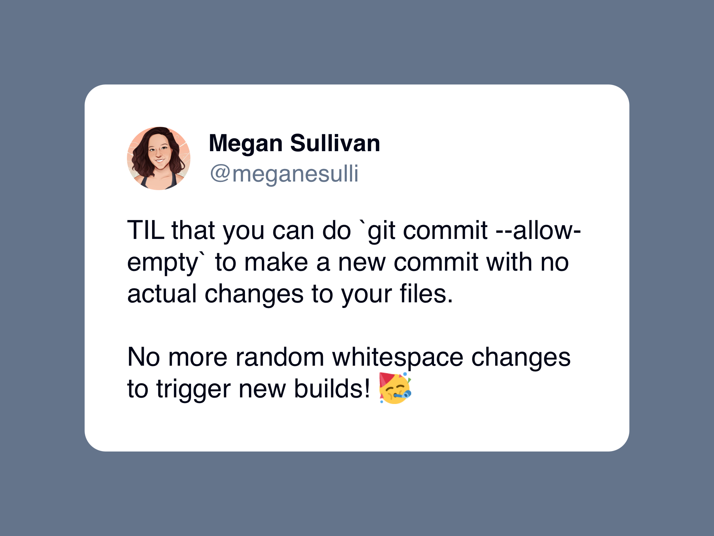

At [ADventori](https://adventori.com/), we use [Gitlab CI](https://docs.gitlab.com/ee/ci/) to deploy our staging environments when code changes in our main branch.
This afternoon, I wanted to re-deploy one of our environments with the same code.

One solution I saw was to add a dummy modification to our codebase (for example adding a space in a comment), commit it, and push it to our main branch.
This would trigger our CI/CD pipeline and would result to a new deployment.
This solves my problem, but the code modification is artificial.

Then, I discovered the `--allow-empty` option of `git commit` thanks to this tweet: 



Eventually, I ran the following command, pushed to our main branch and our staging environment was re-deployed.

```bash
git commit --allow-empty -m 'Redeploy staging environment'
```


